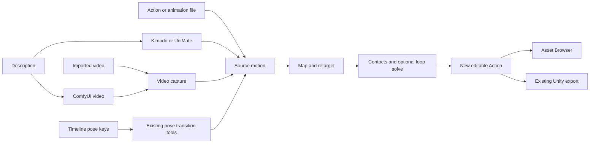

# Rigmodo animation and interface implementation plan

Date: 16 November 2026. Starting point: Rigmodo 0.17.0, commit `5cc5ef9` on `codex/image-pose`.

Rigmodo will support a complete local workflow from a description, video, pose keys, or existing animation to an editable animation on the selected character. Automatic mapping, proportion correction, ground contacts, and optional loop finishing will serve every source. Blender's Asset Browser remains the motion library. Unity remains the primary export target.

The Blender interface will be redesigned around the character and the current task. The first complete delivery includes humanoid video capture, ComfyUI generation, automatic flat-floor contacts, custom animation retargeting, and validated 3D loops. Creature text animation stays available through UniMate; creature video capture is a separate experiment.

## 1. Reuse the existing work

Retain AI and assisted rigging, hand guides, optional twists, AI and geometric skinning, region rules, weight painting, SAM image posing, Kimodo, MotionBricks, UniMate, shared model storage, the local library, and Unity export. Existing files and saved settings need a migration path. New capture code must preserve accepted rest bones, mesh topology, weights, materials, and shape keys.

The local handoff is `C:\Tools\AI\Comfy\MINIMAX_CHARACTER_LOOPS_README.md`. The graph builders are `h3Graph` and `bridgeH3` in `C:\Tools\AI\Emberframe\ui\comfy.js`. These provide implementation references; their runtime-management instructions are not requirements to restart ComfyUI or interrupt someone else's job.

The inspected source confirms first/last-image conditioning, intermediate guides, an optional second upscale pass, 24 fps output, and a loop bridge. It also reveals changes needed for capture:

- `bridgeH3` requests camera movement and enables audio. Rigmodo's capture bridge must request a locked camera and omit audio generation.
- Final-pass conditioning is rebuilt at the larger resolution. Preserve this behavior when supporting that pass.
- Continuation can use an Emberframe-specific context node. Keep the basic presets limited to validated installed nodes; enable optional continuation only when its node is available.
- Matching first/last guide images does not prove identical decoded endpoints or a seamless 3D cycle. Validate the output before removing an endpoint.
- GPU power draw can help diagnosis, but it must not trigger automatic cancellation. Use execution state, errors, memory failures, and explicit cancellation.
- Pixel similarity is a video check. It cannot establish correct joint depth, contact phase, or root motion.

## 2. Blender interface

### Navigation and character selection

Keep one Rigmodo sidebar with three tasks: **Rig / Skin / Animate**. Preserve the existing internal `MOTION` value for file compatibility. Imported rigs can go straight to Animate; this is not a locked sequential wizard.

Put a persistent **Character** selector above the tasks. Use Selection explicitly adopts a rig or a set of unrigged meshes. Clicking a bone, foot marker, mesh, or reference video must not silently change that character. Disambiguate scenes with multiple rigs instead of choosing the first object. Show a brief readiness message and the relevant remedy when something is missing.

Use Blender's theme, fonts, native controls, keyboard navigation, and normal editor behavior. Labels describe tasks; provider names and node IDs stay in preferences or detailed diagnostics. Progress and warnings use words as well as color. Retain reduced-animation support for viewport feedback.

### Rig and Skin

Rig shows **Automatic / Assisted**, character type when relevant, and **Generate Rig**. Assisted mode opens the existing landmark editor. **Edit Joints** opens focused tools for hand guides, optional twists, and joint locks.

Skin shows **Skin Character**, **Test Deformation**, and **Edit Weights**. Its advanced editor contains AI/surface/volume methods, rigid attachments, protected regions, and selected-region refinement. Routine setup and solver iteration defaults belong in preferences; an artist's region assignment stays with the character.

### Animate

Animate has three views: **Create / Browse / Edit**. Each view has one primary operation and shows only its inputs.

```text
Rigmodo                                      Settings
Character  [Avatar                         v] Use Selection
Rig ready · Skin ready

[ Rig ] [ Skin ] [ Animate ]
[ Create ] [ Browse ] [ Edit ]

Create from  [ Description                  v]
Generate     [ 3D motion | Video to motion ]
Motion       [ A quick dodge and counterattack       ]
Length       [ 5.0 seconds ]      [ ] Loop
Movement     [ In place | Root motion ]
Reference    [ Use character image ] [ Choose image ]

                 [ Create Animation ]
Advanced >

Current animation  [ Dodge_01               v] Manage
[ Play ] [ Save to Library ]
```

The source choices are **Description**, **Video**, **Pose keys**, and **Animation**. Description normally uses Kimodo for humanoids or UniMate for compatible creatures; Video to motion selects the ComfyUI route. Video imports an existing clip. Pose keys uses ordinary Timeline keys and the existing transition tools. Animation retargets a scene Action or imported motion file. Engine details remain in preferences.

Loop is an explicit clip choice, initially off for a new unspecified clip. Attacks, deaths, and other one-shot motions stay one-shot unless changed. Movement distinguishes an in-place game cycle from root motion. Duration is shown in seconds; report the actual duration when a generation preset requires a different frame count.

Existing **Use timeline poses** remains available for direct 3D generation. Image guides for generated video have a different purpose: they guide appearance and visible pose, and do not guarantee exact 3D artist keys.

Browse opens the native Asset Browser with the target remembered. Keep full-clip Apply, Preview, and Restore accessible in its header. Family catalogs, tags, thumbnails, search, import, and Save to Library use the existing library. Keep scene Actions and reusable library assets clearly named as separate concepts. Manage contains rename and protected deletion; deletion never purges unrelated Actions or source files.

### Focused Motion Editor

**Edit Motion** opens an opt-in workspace arrangement using Blender's editors and lightweight viewport overlays. Start with this layout rather than a separate embedded application:

```text
Character · Current animation                  [Finish Editing]
+------------------------+-----------------------------------+
| Source video / motion  | Character preview                 |
| synced to time         | ground, soles, contact markers    |
+------------------------+-----------------------------------+
| Timeline: keys, left/right contacts, flagged intervals      |
+-----------------------------------------------------------+
| Mapping | Ground contacts | Loop | Pose                     |
| Only the active tool's controls appear here                |
+-----------------------------------------------------------+
```

The editor supports source/target comparison, uncertain bone assignments, heel/forefoot placement, planted/airborne interval corrections, loop seam preview over three cycles, and ordinary pose-key editing. Contact interval editing needs click and numeric alternatives to dragging. Pause, scrub, undo, and cancel must work predictably. Preserve and restore the previous layout, mode, selection, overlays, frame, and Action when leaving a temporary edit or preview.

Rig and Skin use the same focused-editor pattern with their existing tools. Expensive draw handlers and video decoding run only while the relevant editor is active. Advanced source-video comparison can be closed to recover viewport space.

### Settings ownership

| Location | Settings |
| --- | --- |
| Extension preferences | Providers, model/runtime paths, ComfyUI URL, workflow templates/bindings, devices, quality defaults, cache tools, diagnostics, optional Unity export |
| Character or scene | Bone mapping, calibration pose, sole markers, ground plane, joint limits, protected joints and regions |
| Animation/job | Source, prompt, seed, timestamps, trim, speed, loop period, root-motion policy, contact edits, provenance |
| Temporary editor state | Active tool, layout, pinned selection, preview rollback data |

Do not add an Export workflow tab. Preserve export access through preferences and Blender's normal tools.

## 3. Shared motion pipeline



Preserve the original source motion and each accepted Action. Use temporary evaluation data or worker proxies while processing; apply a successful result as a new Action on the same accepted character by default. Keep an explicit preference for existing review-copy behavior during migration. Do not accumulate visible replacement armatures and meshes in the ordinary workflow.

Extend the existing motion format with a versioned metadata sidecar and only the arrays actually needed: units/axes, physical timestamps, source frame mapping, root/world/camera spaces, confidence, contact probabilities/intervals, skeleton identity, and provenance. Retain raw and processed capture variants. Continue reading existing library clips. Provider-specific SOMA data converts at its adapter boundary; arbitrary motion is not forced through SOMA30.

Remember edits against the correct source and rig fingerprint. Changing a calibration or contact setting should rerun retargeting/cleanup from saved capture data, without regenerating the video or rerunning the vision model. Manual keys, locks, and contact edits take precedence; incompatible requirements produce an actionable conflict instead of silent changes.

Use existing job progress, cancellation, source signatures, and processing effects. Extend the current job mechanism where necessary instead of introducing a second scheduler or general automation framework. GPU stages run sequentially. Blender stays responsive during network requests, capture, and long solves.

## 4. ComfyUI integration

Connect to the existing local service at **http://127.0.0.1:8288** by default, with the endpoint configurable in preferences. Inspect its node schemas, models, queue, and execution history. Do not assume the other Comfy connector's default port identifies this instance. Reuse the external model files in place; do not copy Emberframe's H3 weights into Rigmodo's model folder.

Provide versioned API-workflow templates for **Normal animation**, **Loop animation**, and later **Close an existing clip**. Support user-supplied API JSON with explicit bindings for prompt, seed, duration/frame count, reference images, resolution/quality, and the output node. Validate installed node inputs before submission. Report missing models/nodes without changing a shared runtime's launch flags or whitelist.

For the handoff's H3 profile, preserve its 17k+5 frame constraint, 24 fps output, and dimensions divisible by 32. Validate these against the running node implementation when pinning the profile. The provided examples are 124, 243, and 362 frames; expose their actual duration rather than promising exact 5/10/15-second output. Keep the existing preview-size path and make the larger second pass optional pending capture-quality comparisons.

Use a capture-specific prompt preset: one subject, full body and feet visible, fixed camera, continuous take, plain floor/background, separated limbs, clear movement. Allow custom actions and an explicit prompt override. Reference images can come from disk or a clean temporary render of the selected character. Rendering must restore the user's render/view settings and leave no cameras or floor objects in their scene.

Submit and monitor using ComfyUI's prompt IDs, queue/history, and execution events. Fetch the exact job's video output rather than scanning for the newest file. Convert the ProRes MOV intermediate or other returned video formats when needed; do not assume SaveVideo emits MP4. The existing graph source saves MOV before its own postprocessing. [ComfyUI API](https://docs.comfy.org/development/comfyui-server/comms_routes)

Reuse a running service. Show Waiting for ComfyUI or Waiting for GPU when occupied. Starting a service, if supported, must be an explicit configured action; never start a duplicate or restart Emberframe automatically. Do not clear other clients' queues or unload their active models. Before capture, release generation memory only when the server state and ownership make that safe.

Cancel removes only an owned queued prompt. For a running shared-server job, use prompt-scoped interruption only if supported. Otherwise cancel downstream work and discard its eventual result, explaining that the current external step is finishing; a global interrupt must not stop another client's work. Cache successful stages so a capture failure does not require video regeneration.

## 5. Video capture

First benchmark **GEM-X temporal Body Motion**, with a lightweight MediaPipe-based path as a baseline. Choose the shipping default from actual Windows reliability, retargeted quality, speed, and peak memory. GEM-X is the preferred initial quality candidate, not an established 16 GB performance guarantee. Use a separate provider environment so its dependencies do not replace those used by existing rigging, skinning, or motion providers.

GEM-X exposes temporal world/camera motion, contact predictions, cached inference, and Contact/IK processing. Its contact processing requires a uniformly spaced 30 Hz sequence. Normalize the input for capture while retaining exact source timestamps and a mapping back to 24 fps generation and the user's Blender frame rate. Preserve raw output: its documented grounding can align the lowest joint even without positive contacts, so test airborne motion against the raw prediction. Its hand estimator is a separate path; temporal body capture does not imply equally reliable animated fingers. [GEM-X capture and contact processing](https://github.com/NVlabs/GEM-X/blob/main/docs/DEMO.md#contactik-postprocessing)

Video preflight checks decoding, duration, rotation, variable frame rate, cuts, selected subject, visibility, and large identity/proportion changes. Start with one humanoid and a static camera. Provide a subject picker if detections are ambiguous. Report unreliable frame ranges; do not silently change people or invent high-confidence feet when they are invisible. Preserve intentional fast movement rather than treating all acceleration as tracking noise.

Retain original detections, confidence, camera assumptions, and source movement separately from the baked Action. Capture should create reusable motion independent of the first target avatar. For single-camera footage, absolute scale and depth remain estimates; calibrate against character proportions and ground evidence, and provide a manual override.

For an already cyclic in-place clip, compare direct capture with capture of three repeats and extraction of the middle cycle. Enable this only if it improves the measured result. Do not tile arbitrary traveling or one-shot footage, and preserve the original cycle timestamps when resampling.

## 6. Retargeting and custom animations

Support the existing library and FBX/GLB/glTF/Blender sources, add BVH ingestion, and allow an existing scene Action to be the source. Initially support an active Action or baked evaluated motion; explain preparation for complex NLA/control rigs. Reuse isolation and automatic-script disabling for file imports.

Mapping combines known names/profiles with hierarchy, anatomical proportions, side, and forward evidence. Support A/T calibration, namespaces, differing spine/neck counts, optional twists, helper bones, missing fingers, and root/hips separation. Confidence determines which assignments need review. Save artist corrections for that skeleton. Anonymous or ambiguous rigs must not receive confident-looking guesses without review.

Retarget orientation and travel using target anatomy. Keep bone lengths and accepted rest matrices fixed. Transfer root locomotion separately from pelvis bob and rotation. Keep source joint motion as the starting point; use contact goals and reachable limb lengths to adapt feet and hands. Preserve original Euler orders when restoring older clips, and retain editable direct-bone output.

Local unconstrained deform rigs are the first target. Reject unsupported mirrored/nonuniform scale or drivers with a clear preparation step. A control-rig bake can be an explicit later extension, rather than silently disabling the rig's controls.

## 7. Automatic ground contacts

Ground contacts are enabled by default for supported captured and retargeted motion. First support a flat plane, with world Z=0 as the fallback and an explicit scene ground/height override. Slopes, stairs, moving platforms, palm support, and prop contacts are subsequent extensions.

Estimate heel and forefoot sole locations from the foot/toe mapping and nearby foot or shoe geometry. Exclude nearby accessories when possible. Fall back to calibrated bone markers and flag uncertain estimates. An artist can move the two markers in the viewport and save that calibration for the character. Toyxyz's heel/ball markers and proportion-aware leg controls are useful references. [Toyxyz guide](https://github.com/toyxyz/toyxyz-blender-retargeter/blob/main/docs/USER_GUIDE.md#feet--legs)

Combine learned contact probabilities, foot height, velocity, and motion continuity to propose stance intervals. Require evidence over time so a single noisy frame does not toggle contact. Distinguish left/right stance, double support, heel roll, toe-off, and flight. Retarget these phases to the character, then jointly correct root/pelvis motion and leg pose over an interval with bounded changes. Preserve bone length, knee bend direction, and configured joint limits. Avoid per-frame snapping or forcing a foot onto the floor during a jump.

Evaluate the MIT BVH Motion Retargeter temporal solver against the current two-bone/contact tools. Its documented inputs are manually confirmed contacts; Rigmodo needs its own detector and a way to correct intervals. Reuse a focused compatible module only if it improves contact error without distorting the intended action. [BVH Motion Retargeter](https://github.com/BacteriaJun/BVH-Motion-Retargeter)

Contact correction must run on the target after proportion transfer and remain coupled to loop finishing. Retain the raw source variant and report any unreachable or contradictory contacts. Mesh soles determine visual clearance; an ankle above the floor is not itself evidence that a foot is floating.

## 8. Loops and one-shot animation

Use three video entry methods: matching first/last references for a new cycle, a fixed-camera generated bridge for an existing clip, and pose-aware trimming when a repeat is already present. Intermediate image guides are optional because they can introduce cuts. Do not ship the handoff's unlicensed SPEED interpolation model. Start with trimming; add a separately licensed interpolation option only if capture comparisons justify it.

Validate decoded boundaries before removing duplicate frames. Preserve a source copy and record the selected cycle. Do not use endpoint image similarity as the only acceptance test, and do not assume interpolated pixels provide reliable 3D motion.

After capture, align the cycle's phase, transfer it to the target, and solve contacts and the seam together. Match poses, angular/linear velocity, support phase, and root displacement across the boundary. Compare the last pose with the first pose transformed by the cycle's intended root travel/heading. For in-place cycles, preserve body sway and vertical motion while removing unwanted drift. For root-motion cycles, preserve the intended per-cycle displacement.

Support contact intervals crossing the seam. Use neighboring repeated cycles during optimization when needed, then extract the accepted middle period. Recheck contacts after seam edits and verify that another contact pass does not reopen the seam. Keep one consistent policy for the duplicate endpoint in Action storage, viewport playback, and export, extending the existing loop metadata.

One-shot clips bypass periodic correction. Preserve anticipation, impact, recovery, death holds, and jump flight. Loop preview plays three cycles for review; ordinary attacks and deaths play once. Looping should work with imported/captured Actions as well as generated clips, replacing the current generated-only loop-finishing restriction.

## 9. Storage and provenance

Keep Rigmodo capture weights under `R:\AI\Models\Rigmodo` through the existing model resolver. Resolve compatible installed weights by identity/hash; matching filenames alone are insufficient. Keep ComfyUI's linked model storage in its current location.

Use `R:\AI\MotionLibrary\Rigmodo` for reusable source motion, native Action assets, thumbnails, and metadata. Put new large video/capture job artifacts under a configurable `R:\AI\Rigmodo\Jobs` default. Existing job locations remain readable; no automatic migration or deletion of old jobs is required.

Deduplicate source videos and raw captures by content hash when retained. Save to Library retains enough motion/confidence/contact data to retarget without running capture again; retaining the original video is an optional storage choice. Missing reference video must not prevent playback of an accepted Action. Preferences show storage use and offer explicitly scoped cleanup of derived data, never a global orphan purge.

Record source, workflow/template revision, provider/checkpoint identity, physical timestamps, calibration, contact/loop settings, and license provenance. Keep credentials out of presets, logs, the library, and Git. All default processing stays local.

## 10. Implementation sequence

| Milestone | Deliverable | Completion check |
| --- | --- | --- |
| 1. Interface and state | New character header, Rig/Skin/Animate shell, Create/Browse/Edit, consistent progress, existing tools retained | Existing workflows still accessible; changing object selection does not lose the character; narrow-panel and keyboard review passes |
| 2. Transfer and grounding | Source Action/BVH support, mapping review, calibration, automatic flat-floor contacts, focused Motion Editor | Identity transfer, different proportions, planted feet, and jump flight pass; same accepted rig/skin retained |
| 3. Video capture | Isolated GEM-X evaluation, baseline comparison, timestamps, source preview, cached capture and new target Action | Representative real and generated clips complete locally; quality and memory determine the default provider |
| 4. ComfyUI route | Existing 8288 service, normal/loop templates, custom API workflows, reference image, stage cache and safe cancellation | Prompt produces an exact tracked video artifact and an editable grounded Action without affecting another client's job |
| 5. Periodic finish and release | Coupled loop/contact solve, three-cycle preview, library persistence, Unity verification, complete UI polish | In-place and traveling loops remain continuous; one-shots unchanged; accepted assets survive reopen and round trips |

The first end-to-end acceptance case is a short humanoid walk: description or existing sample video, capture, retarget onto a Ready Player Me avatar, automatic contacts, optional loop, Save to Library, and Unity import. Test a jump and an attack alongside it so a successful walking demo cannot conceal destructive ground locking or unwanted looping.

Within each milestone, keep existing operators behind the new UI until their replacement is tested. Extract UI drawing and shared motion logic incrementally. Do not rewrite inference providers and the entire job framework at the same time.

## 11. Code responsibilities

| Existing area | Planned work |
| --- | --- |
| `ui.py`, `__init__.py`, `configuration.py` | Task navigation, pinned character, minimal registration/settings migrations, provider preferences |
| `landmarks.py`, `hands.py`, `auto_pose.py`, region/weight tools | Reuse existing interaction tools inside focused editing sessions |
| `motion_clips.py`, `animation.py`, `motion_playback.py` | Consistent Action selection, rotation modes, preview rollback, one-shot and loop semantics |
| `motion_library.py`, `motion_assets.py`, `motion_store.py`, library worker | Native browser integration, source metadata, cached capture/contact data, backward-compatible library reads |
| `motion_retarget.py`, `motion_apply.py`, `kinematics.py` | Common mapping/calibration and proportion-aware application; keep provider-specific conversions separate |
| `motion_finish.py` | General source support, periodic boundaries, root travel, contacts at the seam |
| Job/installer modules and `processing_visuals.py` | Extend existing request/status/cancel patterns, staged cache and accurate feedback |
| `exporter.py`, `unity/`, packaging and acceptance tests | Preserve output conventions; add captured/retargeted motion checks and distributable-content validation |

Add small modules only where they have an independent responsibility: a ComfyUI video client with API templates, a video-capture worker/installer matching existing provider patterns, a shared contact solve, and the focused Motion Editor. Keep Blender UI access out of capture workers. Avoid a provider marketplace, general node editor, duplicate asset browser, or new web UI.

## 12. Acceptance checks

- **Scene preservation:** before/after signatures for rig hierarchy/rest matrices, mesh topology, weights, materials and shape keys. No extra accepted meshes or rigs. Preview/cancel restores Action, slot, Euler order, frame, mode, selection and editor layout. Test shared Actions, linked inputs and failure during application.
- **Mapping and transfer:** same-rig identity, Mixamo prefixes, VRM/Ready Player Me, short/tall bodies, changed limb ratios, 3/5 spine bones, twists, missing fingers, anonymous names and ambiguous facing. Bone lengths remain fixed; unsupported transforms fail clearly.
- **Contacts:** walk/run stance, double support, heel roll, toe-off, jump flight, crouch, deliberately sliding feet, and attack impacts. Measure planted-point movement and penetration relative to character scale; compare raw/corrected motion and retain intentional movement.
- **Time and loops:** 24 fps video to 30 Hz capture to 24/30/60 fps scenes; fractional durations; verified duplicate endpoints; cycle phase and velocity; contacts crossing the seam; in-place drift and accumulated root travel; attack/death one-shot behavior.
- **Capture failures:** cuts, occluded/off-screen feet, identity changes, camera motion, changing body proportions and severe jitter. Show affected intervals and retain editable source variants.
- **ComfyUI ownership:** busy service, missing nodes/models, normal and two-pass outputs, rejected prompt, queue cancellation, shared-server running cancellation, restart/reconnect and partial output. Another client's work must remain intact.
- **Persistence and export:** save/reopen/reapply library assets; retained source metadata; complete Action rather than one pose; existing duplicate/locking protections; actual Blender FBX round trip and Unity Humanoid/Generic playback with matching root/loop settings.
- **Hardware and responsiveness:** measure wall time, peak GPU/system memory, disk footprint and cancellation on this RTX 4090 24 GB. A 16 GB claim requires a separate real test. Test 1080p and larger displays, narrow/wide sidebars, keyboard use and reduced motion. Viewport effects and decoder timers stop when idle.

Use synthetic and CC0 fixtures in Git. Private avatars/videos, downloaded weights and account data remain external. Acceptance thresholds are set per fixture and scale; no universal claim of perfect mocap or zero cleanup follows from one example.

## 13. Later extensions and boundaries

Keep UniMate text and matching-skeleton library motion available for creatures. Extend grounding to explicit creature support chains only after validating their labels, including the original Scorpion rig; do not assume humanoid knees or a fixed number of legs. GEM-X's humanoid body model does not provide Scorpion video capture. Evaluate skeleton-conditioned creature approaches separately on the actual target rigs.

Later candidates include richer hands/face capture, palm/object contacts, terrain, multiple people, camera-motion recovery, control-rig baking, and opt-in ExMR/FlowHMR comparisons. Add each only when it improves a tested use case. Heavy simulation tooling and Cascadeur are optional research/cleanup paths, not dependencies of the core Blender workflow.

The H3 adapter remains workflow-configurable. Its published community license excludes the EU from its applicable territory and offers separate licensing; private use does not remove that condition. Model and dependency terms must be checked for the exact checkpoint/profile before deployment. This does not require an H3-specific dependency in the ComfyUI connector. [H3 license](https://huggingface.co/MiniMaxAI/MiniMax-H3/blob/main/LICENSE)

## 14. First implementation task

Start with the native UI shell, persistent character context, and the focused Motion Editor layout, exposing the existing working operators through them. In parallel within the same implementation sequence, prove transfer and automatic contacts on known 3D input. Then use the handoff's already-produced videos to select the capture provider before queuing new generation. This yields a reviewable interface and measurable motion quality before the full description-to-video chain is enabled.

No additional product decisions are required to start this sequence. Runtime schemas, provider compatibility/memory, example-video quality, and checkpoint rights are concrete validation tasks; the README alone does not establish them.
